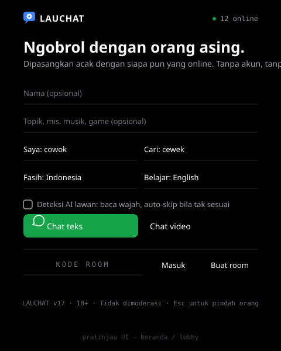
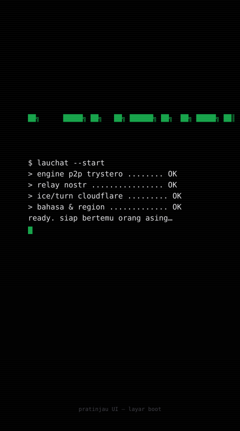
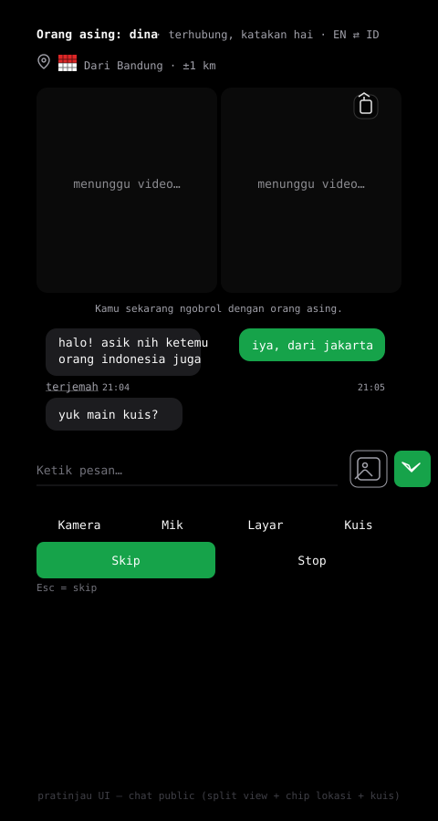
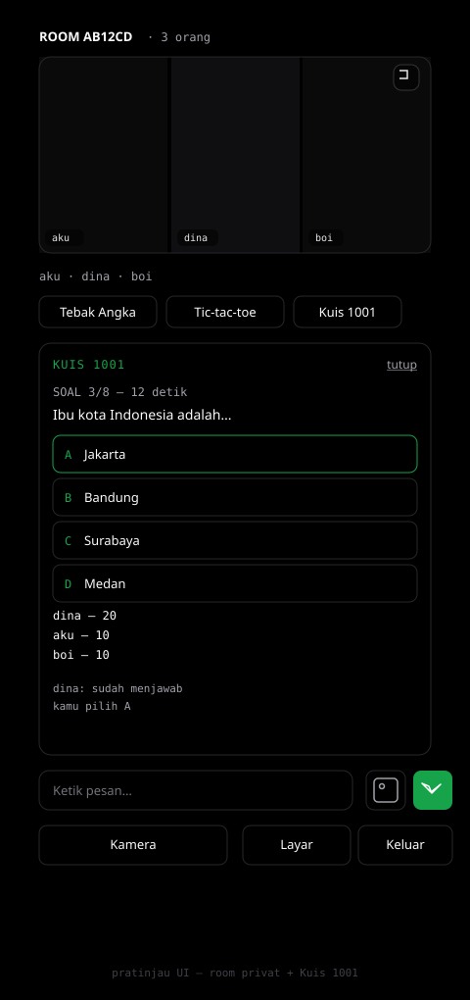
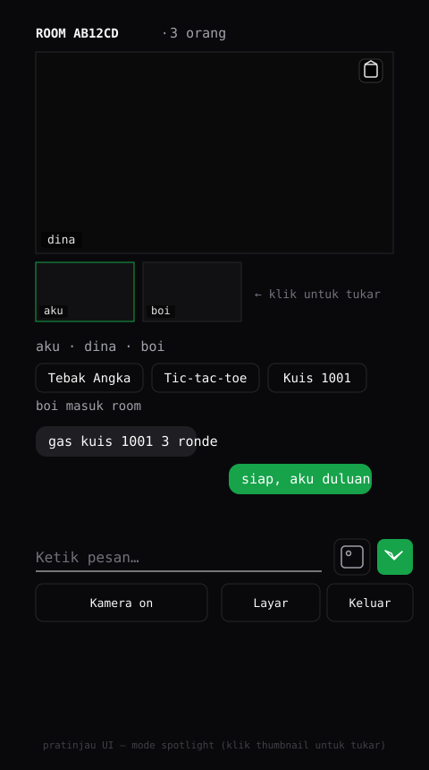
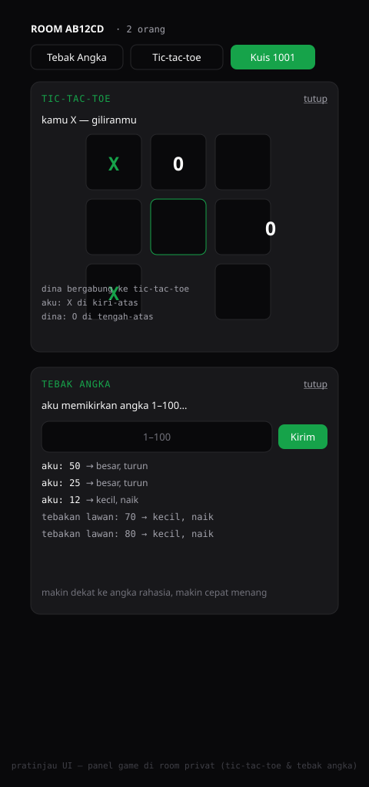

# LAUCHAT

Chat orang asing ala Omegle/OmeTV — satu file HTML, P2P tanpa server aplikasi.

Live: **https://akmalseptain.github.io/lauchat/**

Ketemu orang asing acak, ngobrol lewat teks atau video, main game bareng, atau bikin room privat buat ngajak teman. Semua koneksi langsung antar perangkat (P2P) — tidak ada server yang menyimpan percakapan.

## Pratinjau UI

Gambar di bawah adalah mockup buatan (bukan screenshot runtime), dibuat sesuai tampilan aplikasi.

| Beranda | Layar boot |
| --- | --- |
|  |  |

| Chat public | Room privat — Kuis 1001 |
| --- | --- |
|  |  |

| Mode spotlight | Panel game |
| --- | --- |
|  |  |

## Fitur

### Matchmaking acak

- Bertemu orang asing acak yang sedang online, tanpa akun.
- Filter gender dua arah: pilih identitasmu dan yang kamu cari, sistem menyaring dua-duanya sebelum nyambung.
- Prioritas bahasa: pencocokan lebih suka lawan dengan bahasa yang sama, badge `EN ⇄ ID` menandai pasangan bilingual.
- Tags minat (mis. `mobil, kode, musik`) biar obrolan langsung nyambung.
- AI skip: wajah yang tidak terdeteksi bisa otomatis di-skip (opsional, pakai face-api di browser).

### Chat teks & video 1-on-1

- Tata letak video default atas-bawah ala OmeTV/Umingle: lawan di atas, kamu di bawah, keduanya sama besar; tombol siklus ke berdampingan (split) atau lawan besar + PiP.
- Gerbang konfirmasi 18+ saat pertama kali membuka situs.
- Tombol "Ajak teman": bagikan link via share sheet / tersalin otomatis.
- Bunyi saat ketemu lawan (bisa dimatikan).
- Blokir permanen: lawan yang diblokir tidak akan dipasangkan lagi.
- Suit batu-gunting-kertas bareng lawan — skor berjalan tiap ronde.
- Nonton bareng YouTube: tempel link, play/pause/posisi sinkron dua arah.
- Ejak suara persona: pidato partai, trailer Hollywood, anchor berita, sinden, robot, balita — pitch shift + reverb + vibrato + ring mod.
- Transparansi efek suara: lawan otomatis diberi tahu (pesan sistem + badge "SUARA EFEK") saat efek dinyalakan atau dimatikan.
- 12 preset ejak suara: cewek/cowok natural (PSOLA murni + formant shift, tanpa artefak logam) + 10 gaya publik figur (pidato, ceramah, alam liar, siaran malam, trailer, anchor, stand-up, sinden, robot, balita) — dipilih lewat panel, bukan siklus.
- Simulasi suara pra-chat di beranda — coba preset lewat headset sebelum masuk video chat.
- Video background beranda (abu-abu, opasitas rendah, grayscale).
- Share layar: tampilkan layarmu ke lawan chat.
- Kirim gambar lewat chat, langsung P2P tanpa server.
- Terjemahan pesan sekali klik (MyMemory).
- Chip lokasi lawan: nama kota + jarak ±1 km, dengan kode negara.
- Typing indicator, tema gelap/terang, ikon lucide.

### Room privat

- Buat room dengan kode 4–8 karakter, share kodenya ke teman.
- Chat grup + video mesh: semua peserta saling terlihat.
- Tata letak video: default spotlight — satu video besar + thumbnail (klik thumbnail untuk tukar), bisa diganti ke mode grid.
- Kamera tiap orang bisa on/off sendiri.

### Games

Main bareng lawan chat atau di room privat:

- **Tebak Angka** — angka rahasia 1–100, saling menebak, petunjuk "besar, turun" / "kecil, naik".
- **Tic-tac-toe** — X/O sinkron dua sisi, giliran otomatis.
- **Kuis 1001** — 8 soal pilihan ganda, timer 16 detik per soal, skor real-time semua peserta. Jalan di room privat dan di chat public 1-on-1.

### Lain-lain

- **Layar boot terminal** — logo ASCII + urutan boot ala terminal, tap untuk skip.
- **Service worker anti-stale** — halaman selalu versi terbaru, tidak kena cache lama.
- **Penanda versi** — footer beranda menunjukkan versi build (mis. `v13`), gampang cek versi yang jalan di device.
- 18+, tanpa iklan, tanpa pelacakan.

## Teknis

- **Trystero** (topic nostr) untuk signaling P2P — tidak ada server aplikasi; relay publik hanya untuk salaman koneksi.
- **WebRTC** untuk video/audio/share layar; **TURN via Cloudflare Worker** sebagai fallback kandidat.
- Kirim gambar/gem state pakai chunk biner Trystero.
- Single-file `index.html` (semua UI + logika), plus `sw.js` untuk service worker.
- Ikon lucide, font Geist + Geist Mono, tema gelap default hitam pekat `#000000` (VT323 di layar boot & bendera pixel). UI tanpa kotak: input garis bawah, panel transparan. Ketiga font tertanam base64 di dalam file — tanpa dependensi Google Fonts, tetap tampil benar walau jaringan memblokir font CDN; VT323 versi penuh (karakter blok boot/bendera tidak ada di subset Google).

## Cara pakai

1. Buka https://akmalseptain.github.io/lauchat/
2. Isi nick, pilih gender/kriteria/bahasa, tulis tags (opsional).
3. Klik **Chat teks** atau **Chat video** — tunggu sampai ketemu orang asing.
4. Untuk room privat: tulis kode room, klik **Masuk** (atau **Buat** untuk bikin baru), share kode ke teman.
5. Saat chat: tombol **Kuis** untuk main kuis, **Layar** untuk share screen, ikon klip kirim gambar.

## Struktur repo

```
index.html   — seluruh aplikasi (UI + logika P2P + games)
sw.js        — service worker (anti-stale cache)
docs/img/    — mockup UI untuk dokumentasi
```

## Changelog

- **v7** — penanda versi build di footer (`APP_BUILD`).
- **v8** — bendera negara pixel 5x6 di chip lokasi (flagcdn, render ke blok berwarna).
- **v9** — toggle tata letak video chat 1-on-1: split ⇄ PiP.
- **v10** — room privat (kode, grup chat, video mesh) + game tebak angka, tic-tac-toe.
- **v11** — Kuis 1001 + share layar + kirim gambar.
- **v12** — Kuis 1001 bisa dimainkan di chat public; refactor state game.
- **v13** — perbaikan bug game (guard dua sisi, timer 16 detik, panel bisa dibuka ulang) + tata letak video room: grid ⇄ spotlight.
- **v14** — simplifikasi UI modern ala v0: Geist + Geist Mono di seluruh UI, input & kartu berbingkai radius, bubble pesan asimetris; tema inti zinc + hijau tetap, VT323 hanya boot & bendera pixel.
- **v15** — background gelap jadi hitam pekat #000000 (tanpa tone abu), bubble lawan #1c1c1f.
- **v16** — surface gelap transparan: kartu, panel game, area pesan, dan input nyatu ke background hitam, hanya border 1px; light theme tetap kartu putih.
- **v17** — tanpa grid: input/kartu/panel borderless (garis bawah saja), tombol ghost jadi teks, video room default spotlight, opsi kuis pakai tint; papan tic-tac-toe tetap karena papan permainan.
- **v18** — bendera pixel 5x6 dikembalikan di chip lokasi.
- **v19** — font tertanam base64 (Geist, Geist Mono, VT323 penuh) — tanpa dependensi jaringan; memperbaiki boot logo/bendera yang bocor ke font fallback.
- **v20** — VT323 ke seluruh UI ala terminal (wordmark, hero, label, tombol, status, game, toast, footer); isi bubble chat & kolom ketik tetap Geist.
- **v21** — tata letak kamera atas-bawah (lawan atas, self bawah) ala Umingle/OmeTV jadi default; tombol siklus 3 mode: atas-bawah, berdampingan, PiP.
- **v22** — tata letak atas-bawah disamakan besar (1:1, ala Umingle asli) — bukan lawan dominan.
- **v23** — reset pilihan tata letak lama (sekali) — pengguna awal yang tersimpan mode split/PiP otomatis dapat default atas-bawah.
- **v24** — mode atas-bawah memakai proporsi 3/4 maks 400px di semua layar — kamera tidak terpotong di desktop.
- **v25** — gerbang 18+, tombol ajak teman (share), bunyi saat ketemu lawan (toggle), blokir permanen.
- **v26** — game suit batu-gunting-kertas 1-on-1 (skor berjalan).
- **v27** — nonton bareng YouTube (sinkronisasi dua arah, koreksi drift otomatis).
- **v28** — ejak suara persona (voice changer, AudioWorklet granular pitch shift).
- **v29** — perbaikan: kontrol bawah wrap anti tumpang tindih + pitch shifter 4-tap Hann (suara tidak kresek) + label preset pendek.
- **v30** — label transparansi efek suara ke lawan (disclosure ala EU AI Act).
- **v31** — panel pilihan ejak suara + 4 preset baru (ceramah, alam liar, siaran malam, stand-up).
- **v32** — kontrol bawah di ponsel menjadi grid 5 kolom yang rapi — tidak ada lagi tumpang tindih.
- **v33** — preset suara CEWEK & COWOK natural: pitch shift PSOLA (formant terjaga, bukan efek cempreng) + shift formant granular + EQ tipis; daftar preset bisa di-scroll.
- **v34** — suara cewek/cowok jauh lebih natural: stage pitch-shift granular lama (warna logam) DIBUANG untuk preset CEWEK/COWOK — diganti satu worklet PSOLA dengan formant shift via resampling internal; segmen tak bersuara tidak lagi digrid (anti dengung robot); pitch +7 st.
- **v35** — simulasi suara pra-chat di beranda (tombol Coba suara: dengar hasil preset lewat headset sebelum masuk chat), video background beranda (bg.mp4, grayscale, opasitas rendah), simplifikasi beranda (hero & opsi lebih ringkas).
- **v36** — video background diredupkan (brightness turun, opasitas .14, blur halus, scrim radial) agar teks beranda tetap terbaca jelas.
- **v37** — video background bersih: grayscale + opasitas .15 saja, tanpa brightness/blur/scrim — abu-abu lembut, teks tetap tajam.
- **v38** — video background lebih terang: grayscale + brightness 1.25 + opasitas .42 — abu-abu jelas kelihatan, tidak gelap lagi, teks tetap terbaca.
- **v39** — teks beranda diberi glow gelap (text-shadow hitam halus) agar tetap jelas di atas video yang kini lebih terang — video tetap abu-abu terang, teks tetap putih tapi kontras.
- **v40** — video background kembali redup (grayscale, opasitas .20, tanpa brightness boost) — tema gelap dipertahankan, teks putih jelas; glow tipis dipertahankan sebagai jaring pengaman di bagian video yang terang.
- **v41** — video background full viewport di desktop (position:fixed — sebelumnya terjebak di kolom 560px) + header transparan di beranda (video terlihat sampai ke atas, blur header nonaktif di home saja).
- **v42** — fix header transparan saat pertama kali buka (class on-home kini hardcoded di body; sebelumnya baru aktif setelah pindah view).
- **v43** — header dinamis di beranda: transparan saat halaman di puncak, berubah jadi frosted blur saat di-scroll ke bawah agar konten yang lewat tidak ketimpa teks header.
- **v44** — suara CEWEK/COWOK diganti ke Signalsmith Stretch (library pitch/formant shifter open source MIT kelas industri, WASM ter-vendored utuh di file): pitch ±7 semitone dengan geser formant ±2.5 semitone terkompensasi + tonality preservation, block 40ms (latency 40ms), jauh lebih halus dari PSOLA lama; preset lama tetap jadi fallback otomatis kalau WASM gagal dimuat.
- **v45** — fix video latar ikut membesar saat scroll di Chrome Android (backdrop-filter di header scrolled memicu bug magnifikasi elemen fixed — diganti latar solid 94%); suara CEWEK/COWOK dinaikkan ke ±9 semitone dengan formant ±4 semitone + block 60ms + splitComputation (kualitas & pitch tracking jauh lebih stabil di shift besar, clarity output bahkan naik); toast simulasi/ejak kini menampilkan engine aktif (Stretch/PSOLA) untuk memudahkan diagnosis.
- **v46** — fix definitif video latar ngezoom saat scroll: penyebab sebenarnya adalah address bar Chrome Android yang mengecil saat scroll → viewport berubah → video fixed ukuran persen ikut membesar dan object-fit:cover me-recrop. Video k dikunci ke ukuran large viewport (100vw × 100lvh) yang konstan, plus diberi layer compositor sendiri — tidak ada re-crop, tidak ada zoom.
- **v68** — musik bareng di room privat atas permintaan pengguna: tombol Musik di bar room membuka panel MUSIK BARENG — tempel link YouTube lagu, tekan Putar, dan seluruh member bisa ikut mendengar dengan posisi lagu tersinkron (siapa pun bisa menambah lagu ke antrean, pemutar berpindah otomatis saat lagu selesai). Sinkronisasi mengikuti pola nonton-bareng: siapa yang memutar lagu memegang kendali (play/pause/lewat), posisi dikirim berkala tiap 5 detik dan listener otomatis menyesuaikan jika drift lebih dari 3 detik; DJ keluar room tidak menghentikan lagu di sisi lain, dan member yang belum ikut cukup menekan satu tombol untuk masuk di posisi lagu saat ini. Antrean dibagi ke semua member (maksimal 20, DJ bisa menghapus). Test Node 42/42 PASS (parsing link YouTube semua format, alur DJ-antrean-lagu berikutnya, sinkron play/pause/drift, penolakan DJ palsu, pembersihan state).
- **v67** — dua fitur baru atas permintaan pengguna: (1) **Truth or Dare** untuk chat 1-on-1, lewat tombol ToD atau perintah /tod — deck 24 pertanyaan jujur dan 24 tantangan acak, bergantian giliran dengan lawan: pilih TRUTH atau DARE, promptnya kelihatan di kedua layar, tekan SELESAI untuk mengalihkan giliran; lawan mengajak main otomatis membuka panel. (2) **Filter negara** saat mencari lawan: pilih negara idaman (Indonesia, Malaysia, Jepang, Korea, dan lainnya) di beranda — pencocokan dua arah, lawan dari negara yang tidak cocok otomatis dilewati, dan lawan yang menyaring negaramu juga bisa memverifikasi lokasimu lewat kode negara dari geolokasi (dibulatkan, tanpa koordinat persis). Test Node 60/60 PASS (alur host-klien, penolakan giliran, deck utuh, dua arah filter, plus regresi BIG TWO).
- **v66** — chip kombo BIG TWO atas permintaan pengguna (tahu combo apa saja di tangan dan bisa menekannya): kini di atas kartu tangan muncul deretan chip yang mendeteksi otomatis semua kombinasi yang tersedia dari kartu yang sedang dipegang — PASANG, TRIPLE, DUA PASANG, EMPAT SEKAWAN, FULL HOUSE, STRAIGHT, FLUSH, STRAIGHT FLUSH, ROYAL FLUSH — lengkap dengan detailnya (misal PASANG 8, STRAIGHT 3-7, FLUSH HATI). Menekan chip langsung memilih kartu penyusunnya (tekan lagi untuk batal), lalu tinggal MAINKAN. Chip yang tidak mengalahkan kombinasi di meja atau saat bukan giliran tampil redup dan tidak bisa ditekan, jadi langsung kelihatan kombo mana yang aman dimainkan. Deteksi menormalkan kekuatan sesungguhnya (straight yang kebetulan sekawan dihitung straight flush, tanpa chip duplikat) dan hanya menampilkan kombinasi dari kartu milik sendiri. Test Node 56/56 PASS termasuk regresi penuh aturan kombinasi, alur klik-by-ID dua sisi, dan interaksi chip (pilih, batal, chip mati, bukan giliran, selesai).
- **v65** — penyempurnaan HD dan kejelasan seluruh UI atas permintaan pengguna (perbaiki uinya jadi lebih bagus, HD, jelas, semuanya): rendering teks global dihaluskan (antialiasing font + optimizeLegibility) sehingga tulisan tajam di semua layar; kontras warna teks sekunder dinaikkan (muted lebih gelap di mode terang, lebih terang di mode gelap) dan garis batas dark mode sedikit dipertegas; ukuran teks dinaikkan di seluruh permukaan — pesan chat, input, tombol, pertanyaan kuis, footer, toast, teks boot — serta tombol dan kolom input lebih besar (44px) agar nyaman disentuh di HP; fokus keyboard kini punya cincin hijau yang jelas; doodle duel kini HD (canvas internal mengikuti devicePixelRatio sampai 2x, ketebalan garis ikut terskala); kualitas video dan share layar dinaikkan (kamera fallback meminta 1280x720, share layar meminta 1080p); foto SIAPA HAYO dan gambar di chat ditampilkan lebih besar. Test Node 43/43 PASS (regresi penuh BIG TWO: kombinasi termasuk two pair/royal flush, alur klik-by-ID host dan klien, saringan kartu asing, menang + reveal, plus verifikasi doodle HD dan CSS HD).
- **v64** — perbaikan bug fatal gameplay BIG TWO yang dilaporkan pengguna: pilihan kartu disimpan dan dikirim sebagai INDEX array tangan, tapi validator host membandingkannya dengan ID kartu — akibatnya kombinasi yang sudah sesuai ditolak diam-diam tanpa pesan, dan kalau indeks kebetulan sama dengan sebuah ID kartu yang ada, kartu yang dimainkan jadi kartu lain. Sekarang pilihan = ID kartu konsisten dari klik canvas sampai validasi host (klik -> MAINKAN -> pk-play -> host), engine canvas membaca pilihan via ID, dan saringan keamanan memastikan hanya kartu milik sendiri yang terkirim. Canvas kini HD: resolusi internal mengikuti devicePixelRatio (sampai 2x, 960x720) dengan transform skala, teks dan kartu tajam di layar retina. Test Node 26/26 PASS termasuk simulasi dua sisi penuh: host klik-main, klien klik-main-kirim-host-validasi, pasangan, kartu asing ditolak, menang, deal ulang.
- **v63** — BIG TWO ditulis ulang sebagai engine canvas penuh dengan rAF loop seperti WAR, bukan lagi kartu DOM: semua digambar tiap frame di canvas (meja felt hijau, kartu putih rounded digambar manual, punggung bergaris diagonal), kartu punya identitas sehingga saat dimainkan KARTUNYA BENAR-BENAR TERBANG dari tangan ke meja (posisi lama dipertahankan lalu meluncur ke target), lawan main dari atas, deal terbang dari tumpukan dengan jeda beruntun, kartu terpilih menyala hijau dan naik, tap langsung di canvas (hit-test), partikel ledakan dengan gravitasi di kombinasi besar dan saat menang, screen shake, SFX WebAudio (bunyi pilih, main, lewat, kombinasi besar, fanfare menang). Kejelasan gameplay: status validitas kombinasi live (nama kombinasi + siap dimainkan / tidak valid / harus lebih tinggi dari apa), label siapa yang main kombinasi terakhir konsisten di kedua sisi (bug lama host tidak tahu kombinasinya sendiri), teks giliran berdenyut, pesan host di tengah meja. Loop berhenti sendiri saat panel ditutup. Test Node 46/46 PASS (logika kombinasi, layout engine, transisi kartu hand->table, reveal, deal ulang, deck 93, 15 ronde).
- **v62** — BIG TWO dirombak total supaya terasa seperti game kartu Android asli, bukan baris teks: kartu kini berwajah asli (kartu putih rounded dengan bayangan, angka+suit di pojok, suit besar di tengah, merah untuk hati/wajik), tangan sendiri jadi kipas kartu overlap yang bisa digeser horizontal (kartu terpilih meloncat keluar dengan ring hijau, hover terangkat), punggung kartu lawan overlap dengan motif garis diagonal, meja di tengah menampilkan kombinasi terakhir dengan kartu lebih besar + chip nama kombinasi, pil status GILIRANMU berdenyut hijau saat giliranmu, animasi kartu pakai easing pantat (bounce), deal terbang dari atas meja, flash teks tidak lagi menumpuk kalau aksi cepat bertubi-tubi. SIAPA HAYO: deck dari 68 jadi 93 figur — 11 artis Indonesia baru (Maudy Ayunda, Dian Sastrowardoyo, Nicholas Saputra, Tulus, Iko Uwais, Joe Taslim, Sherina, Krisdayanti, Glenn Fredly, Pevita Pearce, Fedi Nuril) dan 14 Hollywood baru (Tom Hanks, Leonardo DiCaprio, Keanu Reeves, Dwayne Johnson, Ryan Gosling, Chris Evans, Robert Downey Jr., Johnny Depp, Brad Pitt, Tom Cruise, Will Smith, Hugh Jackman, Charlize Theron, Natalie Portman), semua foto Wikimedia Commons lisensi bebas terverifikasi. Test Node 41/41 PASS.
- **v61** — BIG TWO kini ada animasi ala WAR!: kartu dibagikan berjalan masuk satu per satu, kartu yang dimainkan melambai masuk ke baris terakhir dengan jeda beruntun, hover kartu milik sendiri terangkat, LEWAT memunculkan flash teks + panel bergetar, kombinasi besar (full house ke atas dan ROYAL FLUSH) memunculkan nama kombinasi besar di tengah + ledakan partikel warna + getar, menang membuka kartu lawan dengan animasi flip + hujan partikel + flash KAMU MENANG; deteksi animasi dua sisi (host & klien) via id deal + sidik jari kombinasi terakhir di payload pk-you. SIAPA HAYO: deck membengkak dari 36 jadi 68 figur dengan 32 artis Korea baru (BLACKPINK Lisa, TWICE Nayeon/Tzuyu/Sana, Red Velvet Irene/Seulgi/Joy/Yeri, aespa Winter, Taeyeon, aktris Son Ye-jin/Jun Ji-hyun/Kim Tae-hee/Lee Young-ae/Han So-hee, aktor Gong Yoo/Hyun Bin/Lee Min-ho/Song Joong-ki/Kim Soo-hyun/Park Seo-joon, BTS V/Jungkook/Jimin/RM/Jin/Suga/J-Hope, G-Dragon/Taeyang/Key/BoA), semua foto Wikimedia Commons lisensi bebas terverifikasi; ronde tebakan dinaikkan dari 5 jadi 15 per partai. Test Node 35/35 PASS (regresi kombinasi, deal id, payload animasi, deck 68 unik, 15 soal terpilih).
- **v60** — SIAPA HAYO deck digedekan dari 24 jadi 36 figur dengan tambahan artis cantis Korea dan Hollywood, semua foto Wikimedia Commons lisensi bebas terverifikasi bisa diakses: Korea (Song Hye-kyo, Bae Suzy, Jennie dan Jisoo BLACKPINK), Hollywood (Scarlett Johansson, Margot Robbie, Zendaya, Anne Hathaway, Emma Stone, Gal Gadot, Emma Watson, Jennifer Lawrence). BIG TWO disesuaikan dengan ranking tangan poker konvensional ala tongkrongan (bukan betting, bukan capsa susun): kombinasi 5 kartu DUA PASANG (two pair + kicker) kini valid dan jadi 5-kartu terendah (dua pasang < straight < flush < full house < empat sekawanan < straight flush), straight flush As-tinggi ditampilkan sebagai ROYAL FLUSH, dan panel game menampilkan baris urutan kombinasi. Test Node 56/56 PASS (two pair valid/invalid/kicker tiebreak/urutan vs semua kategori, royal flush label, regresi semua kategori v59, deal/play/pass/menang/reveal, deck 36 foto + jawaban unik).
- **v59** — dua game dirombak: (1) POKER diganti BIG TWO ala capsa tongkrongan via /poker atau /bigtwo (chat 1-on-1) — tanpa betting/ante sama sekali, tiap pemain pegang 13 kartu, buang kombinasi 1/2/3/5 kartu (satu, pasang, triple, straight, flush, full house, empat sekawanan, straight flush), pemegang kartu terkecil jalan duluan, harus lebih tinggi dari kombinasi terakhir lawan (kategori lebih tinggi menang; sesama 5-kartu: straight flush > empat sekawanan > full house > flush > straight; sesama kategori banding nilai lalu suit S>H>D>C, 2 tertinggi), lewat dua kali berturut-turut = lawan bebas main apa saja, kartu habis duluan = menang dan sisa kartu lawan dibuka, tombol MAINKAN/LEWAT/MAIN LAGI, klik kartu untuk pilih; host authoritative, pesan pk-* dipertahankan (type 'poker'). (2) SIAPA HAYO sekarang menampilkan FOTO asli selebritis (24 foto dari Wikimedia Commons, lisensi bebas, semua terverifikasi dapat diakses) — tebak dari foto, clue teks tetap jadi bonus tiap 12 detik (poin 100/75/50); Nike Ardilla diganti Rhoma Irama dan Justin Bieber diganti Billie Eilish karena fotonya tidak tersedia dengan lisensi bebas. Test Node 61/61 PASS (kombinasi valid/invalid semua kategori, aturan mengalahkan, deal 13/13 + giliran awal, main/lewat/menang/reveal, payload sinkronisasi, deck 24 foto unik, sh-state kirim foto).
- **v58** — dua game baru: (1) POKER heads-up 5-card draw via /poker (chat 1-on-1) — chip 100 lawan 100, ante 10 tiap hand, giliran bergantian (hand ganjil A duluan), ronde bet CHECK/BET 10/CALL/FOLD, fase tukar kartu (klik kartu untuk pilih, TUKAR n / LEWAT, A dulu lalu B), showdown dengan evaluasi tangan lengkap (kartu tinggi sampai straight flush, seri = pot dibagi); kartu DOM terminal (S/H/D/C, merah untuk H/D), punggung kartu lawan tersembunyi sampai showdown, fold tidak membuka kartu; host authoritative — kartu lawan tidak pernah dikirim sebelum showdown. (2) SIAPA HAYO tebak selebritis via /siapa — deck 24 figur Indonesia + dunia dengan 3 clue bertahap (makin sedikit clue yang terbuka, poin makin besar: 100/75/50), clue baru tiap 12 detik, 5 ronde, kedua pemain balapan jawab lewat input, jawaban dinormalisasi (tanpa spasi/tanda, case-insensitive) dengan alias, waktu habis = jawaban dibocorkan, timer host dibersihkan saat panel ditutup/cleanup. Keduanya pair-only dengan guard anti-tabrakan ke semua game (suit, kuis, tebak angka, TTT, doodle, WAR) dan sebaliknya; /help diperbarui. Test Node 63/63 PASS (evaluasi tangan poker semua kategori, alur bet/call/fold/swap/showdown, invarian chip 200, pot dibagi, game over chip habis; normalisasi siapa, poin per clue, ronde & juara/seri).
- **v57** — WAR! diperbarui jadi rasa game PS1: latar parallax senja (gunung, bukit, kota siluet dengan jendela menyala, bulan, bintang) yang bergulir, sprite pixel (trooper dengan helm/senapan/animasi jalan, soldier dengan helm + rifle, boss mech dengan turret + rantai roda bergerak + pip HP), musuh sekarang balas menembak (peluru bisa dihindar dengan lompat), ledakan partikel + screen shake + muzzle flash + popup skor, drop medkit +1 HP dari boss, efek suara sintetis (tembak, lompat, kena, ledakan, heal — tombol SUARA/BISU), scanline CRT + vignette + pixelated rendering (kelas war-cv, aspect 16:9), perbaikan bug v56: skor host untuk kill sendiri tidak pernah bertambah.
- **v56** — WAR! game run & gun co-op ala Metal Slug (original, bukan milik SNK) di chat 1-on-1: ketik /war dan kanvas game terbuka otomatis di kedua sisi; gelombang musuh terus naik (5+2 per wave, kecepatan naik), boss HP 12 tiap 5 wave; 3 nyawa, tembak cooldown 9 frame, peluru & posisi tersinkron real-time (host sim, klien lerp); kontrol tombol layar (HP) dan panah+W+space (desktop); game over saat kedua pemain tumbang.
- **v55** — tiga fitur interaktif baru: (1) slash command terminal di kotak chat 1-on-1 maupun room — /flip, /roll (default d6, /roll d20 dsb, clamp 2-1000), /8ball <pertanyaan>, /me <aksi>, /ice, /help; hasil perintah terkirim ke lawan sebagai pesan biasa, /help hanya lokal; (2) kartu ICEBREAKER — 24 pertanyaan pembuka percakapan, tombol Icebreaker di kontrol chat atau ketik /ice; (3) DOODLE DUEL — kanvas gambar kolaboratif real-time dengan lawan di chat 1-on-1 (tombol Doodle): 5 warna, 3 ketebalan, hapus, sinkron goresan per segmen koordinat ternormalisasi, guard anti-tabrakan dengan semua game lain; grid kontrol mobile menjadi 4 kolom (12 tombol, 3 baris rapi).
- **v54** — koreksi informasi rekam (riset): suara dari Chrome Android TIDAK bisa ditangkap perekam layar sistem sekalipun sumbernya sudah diatur ke suara internal — Chrome menandai audionya non-capturable dan Android memblokir penangkapannya (AudioPlaybackCapture hanya mengizinkan kategori media/game; audio terkait mic/panggilan diblokir anti-wiretapping; Google menandai masalah ini tidak akan diperbaiki). Dialog konfirmasi dan toast tombol rekam diperbarui: video halaman via Screen Recorder (hening), suara hanya lewat tombol rekam in-app.
- **v53** — fix rekaman tanpa suara (video jalan, audio kosong): AudioContext perekam dulunya dibuat SETELAH await izin kamera/layar — saat itu izin gesture pengguna sudah hangus sehingga di Android Chrome konteks nyangkut "suspended" dan audionya tidak pernah tercatat. Sekarang konteks audio dibuat tepat saat tombol ditepat (gesture masih valid) + auto-resume lewat listener pointerdown/touchstart yang dibersihkan saat rekaman berhenti; berlaku untuk mode rekam layar, sesi chat, dan rekam diri.
- **v52** — mode rekam diri kini minta konfirmasi dulu (jangan langsung buka kamera): dialog menjelaskan bahwa browser HP tidak bisa merekam halaman web dan menawarkan rekam kamera+suara efek sebagai gantinya; batal = toast tips pakai Screen Recorder bawaan Android (quick settings) dengan sumber suara "perangkat/internal".
- **v51** — mode rekam diri: di Android TIDAK ada browser yang bisa merekam layar halaman web (Chrome Android tidak mengimplementasikan getDisplayMedia sejak v89 — ini batasan platform, bukan bug). Tombol rekam header kini otomatis berjalan penuh di HP: saat chat video → rekam sesi (v50); di luar chat → rekam diri — kamera depan (mirror selfie) + suara efek simulasi jika aktif (atau suara mentah mic) → video webm/mp4 tersimpan. Untuk merekam seluruh halaman (UI) di HP: screen recorder sistem — tetapi TANPA suara (lihat v54: Chrome memblokir audionya dari perekam layar).
- **v50** — fallback perekam sesi untuk browser tanpa rekam layar (browser dalam aplikasi/WebView): kalau getDisplayMedia tidak tersedia tapi lagi di chat video, tombol rekam otomatis beralih ke mode rekam sesi — video lawan + video sendiri digabung di canvas (640x480, crop tengah), suara lawan + suara sendiri (termasuk efek suara) dicampur, hasil video webm/mp4 otomatis tersimpan; di beranda tetap disarankan tombol Rekam audio atau buka di Chrome.
- **v49** — tombol rekam seluruh halaman: ikon titik merah di header merekam layar app dari dalam (getDisplayMedia + MediaRecorder) — video UI + suara internal app ikut terekam; saat efek suara aktif di chat, suara efek sendiri (yang tidak terdengar lokal) otomatis dicampur ke rekaman; timer durasi di header; tap ikon lagi = stop & auto-download webm/mp4; tidak dukung di iPhone Safari (pakai tombol Rekam audio).
- **v48** — tombol REKAM di panel simulasi suara: masalah user "recorder layar cuma nangkep suara mic/keluarnya, suara hasil simulasi gak kerekam" — sekarang panel simulasi punya tombol rekam internal yang menyadap output rantai efek langsung di Web Audio (MediaStreamDestination + MediaRecorder), bukan mikrofon: hasil rekaman = persis suara hasil efek yang terdengar di speaker, tanpa bocoran suara luar. Format auto webm/opus (Android/Chrome) atau m4a (iOS fallback), timer MM:SS di tombol, auto-download ke folder Download dengan nama lauchat-<preset>-<unix>.webm. Perekaman otomatis selesai (dan tersimpan) saat ganti preset, STOP, atau keluar dari beranda.
- **v47** — suara CEWEK di-dandani jadi seksi & deep atas masukan user: pitch turun dari +9 ke +8 semitone (110→175Hz, area sultry alih-alih cerah/tinggi), formant dikembali ke +2.5 semitone (resonansi lebih gelap dan hangat), boost kecerdasan 3.1kHz dibuang dan diganti lowshelf hangat 200Hz — karakter suara perempuan dewasa, bukan cewek ceria.

## Catatan

- 18+. Konten dari orang asing tidak dimoderasi — skip atau stop kapan saja.
- Tidak ada server yang menyimpan pesan/gambar/video; semuanya langsung antar perangkat. Relay nostr hanya untuk signaling, TURN hanya meneruskan media terenkripsi.
- Lokasi hanya selevel kota + jarak ±1 km, tidak pernah koordinat persis.
